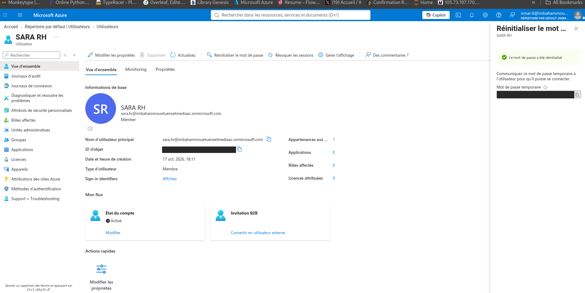
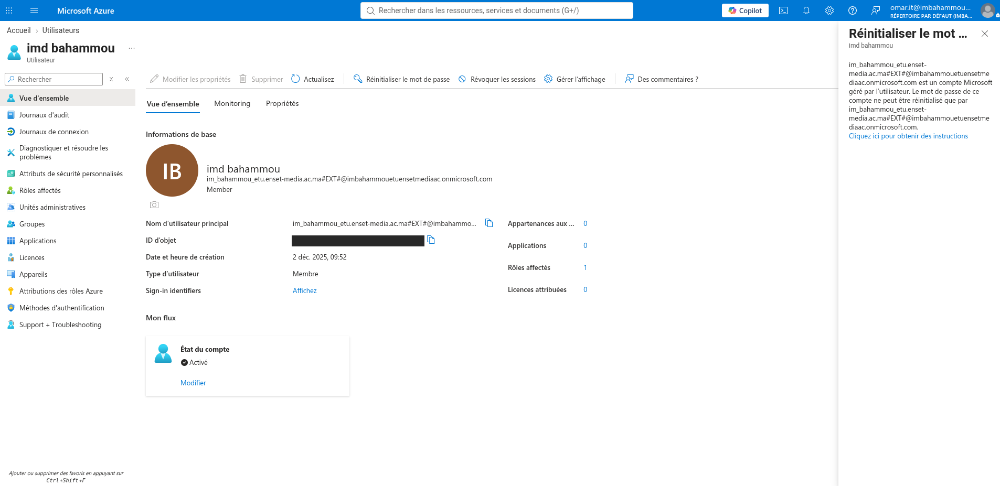

# Lab 01 – Microsoft Entra ID: Users, Groups, Roles & Least Privilege

> AZ-104 preparation · Domain: **Manage Azure identities and governance**
> Environment: Azure for Students subscription · Microsoft Entra ID (Free tier)

## 🎯 Goal

Simulate a small company IT team in Microsoft Entra ID:

- Create users and a security group
- Give **access to Azure resources** with Azure RBAC
- Delegate **password resets** to a helpdesk user with an Entra ID role
- Prove the **principle of least privilege** with real tests

## 🏗️ What I built

| Type | Name | Details |
|---|---|---|
| User | Ali IT | Department: IT |
| User | Omar IT | Department: IT · Entra role: **Helpdesk Administrator** |
| User | Sara HR | Department: HR |
| Security group | GRP-IT | Members: Ali IT, Omar IT |
| Resource group | rg-lab1 | Region: France Central |
| Azure RBAC | Reader on `rg-lab1` | Assigned to **GRP-IT** (group, not users) |

## 🛠️ Steps

1. **Users**: created 3 cloud users in Entra ID with department and usage location.
2. **Group**: created the security group `GRP-IT` with assigned membership.
3. **Azure RBAC**: created `rg-lab1` and assigned the **Reader** role to `GRP-IT` at resource group scope.
4. **Entra role**: assigned **Helpdesk Administrator** to Omar IT.
5. **Password reset**: signed in as Omar and reset Sara's password. Sara signed in with the temporary password and was forced to choose a new one.

## ✅ Tests and results

| # | Test | Expected | Result |
|---|---|---|---|
| 1 | Omar (Helpdesk Admin) resets Sara's password | Allowed | ✅ Allowed |
| 2 | Sara signs in with the temporary password | Must change password | ✅ Forced to change it |
| 3 | Omar tries to reset the Global Administrator's password | Blocked | ✅ Blocked |
| 4 | Omar tries to edit the admin's properties | Blocked | ✅ "Edit properties" greyed out |

## 💡 What I learned

- **Entra ID roles vs Azure RBAC roles**
  - *Entra roles* manage **identities**: users, groups, passwords, licenses.
  - *Azure RBAC* manages **resources**, with three parts: **who** (security principal), **what** (role), **where** (scope).
- **Least privilege**: give only the access needed for the job. Helpdesk Administrator can reset normal users' passwords but **cannot** reset a Global Administrator's password.
- **Assign access to groups, not users**: new team members get access automatically.
- **External users (`#EXT#`)**: an account from another directory keeps its password managed in its home directory. Even a Global Administrator here cannot reset it.
- **SSPR (Self-Service Password Reset)** for cloud users needs **Entra ID P1 or P2**. It was not available on this student directory, so I tested the helpdesk reset flow instead.

## 🔜 Next steps

- Enable SSPR with group-based licensing when an Entra ID P1/P2 license is available
- Lab 02: Azure governance (RBAC, Azure Policy, resource locks, budgets)

## 📸 Screenshots

**Omar (Helpdesk Administrator) resets Sara's password: allowed**

**Omar tries to reset the Global Administrator's password: blocked**

> Passwords and object IDs are hidden.

---
*Part of my 6-month journey to become a Cloud Infrastructure Engineer.*
