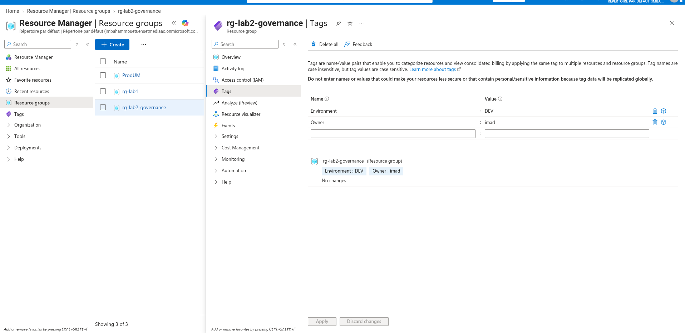
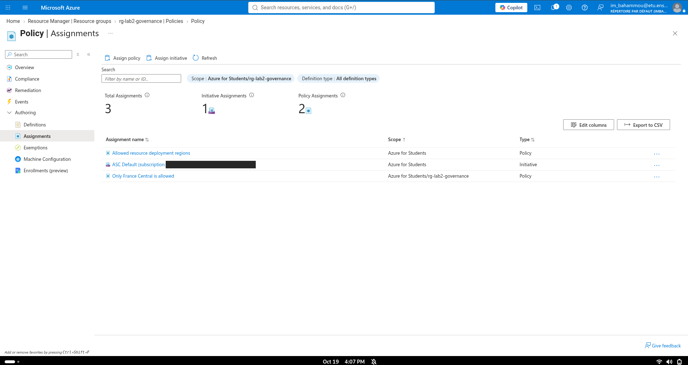
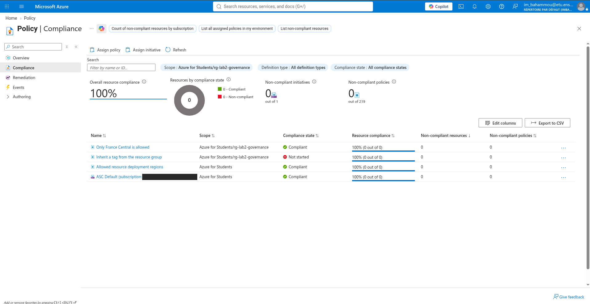
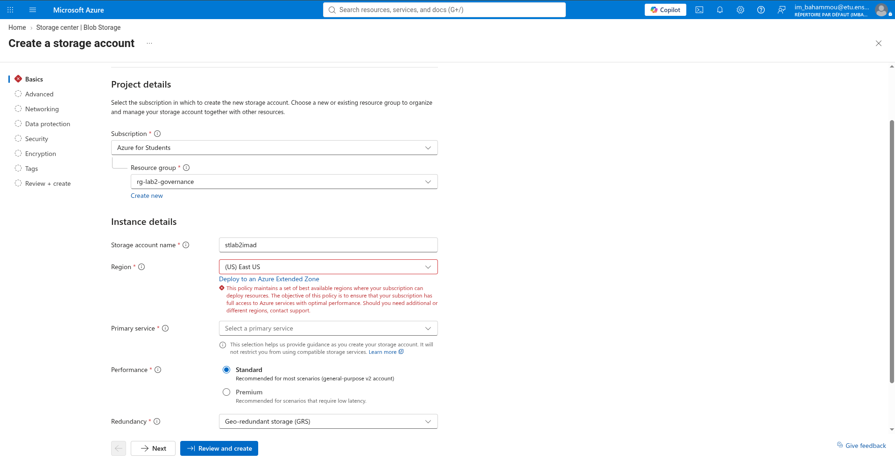
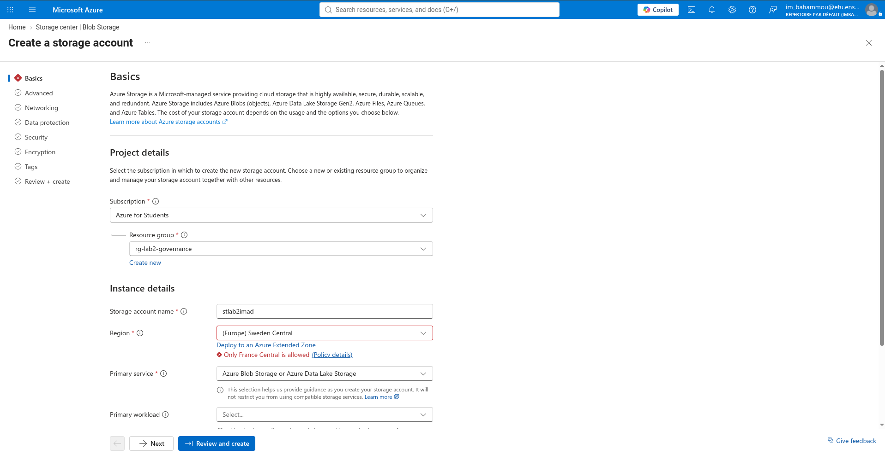
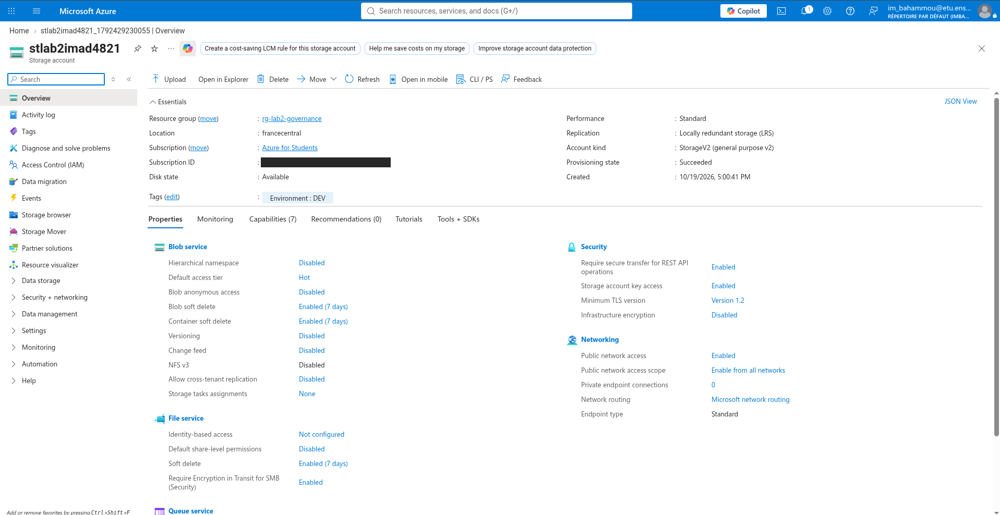
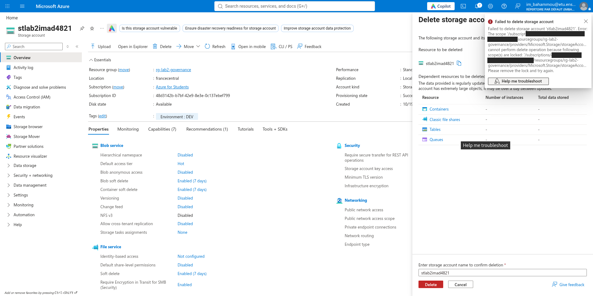
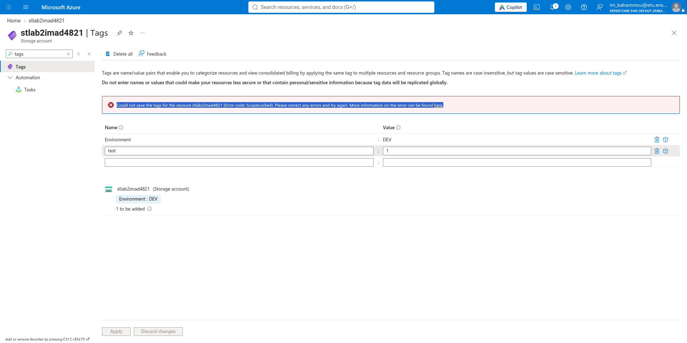
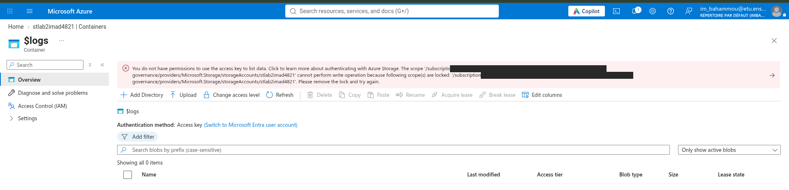

# Lab 02 – Azure Governance: Tags, Azure Policy and Resource Locks

> AZ-104 preparation · Domain: **Manage Azure identities and governance**
> Environment: Azure for Students subscription

## 🎯 Goal

Apply company-style governance rules to a resource group and prove they work:

- **Tags** to label resources (owner, environment)
- **Azure Policy (Deny)** to allow only one region
- **Azure Policy (Modify)** to add a missing tag automatically
- **Resource locks** to protect resources, even from the Owner

> **RBAC** = *who* can act · **Policy** = *what* is allowed · **Lock** = *protect* what exists

## 🏗️ What I built

| Type | Name | Details |
|---|---|---|
| Resource group | `rg-lab2-governance` | France Central · Tags: `Environment: DEV`, `Owner: imad` |
| Policy assignment (Deny) | Only France Central is allowed | Built-in *Allowed locations* · Scope: resource group |
| Policy assignment (Modify) | Inherit a tag from the resource group | Built-in *Inherit a tag from the resource group if missing* · Tag: `Environment` · System-assigned managed identity |
| Storage account | `stlab2imad4821` | Test resource · Standard LRS · Created **without** tags |
| Resource locks | `lock-no-delete`, `lock-read-only` | Delete lock, then Read-only lock |

## ✅ Tests and results

| # | Test | Expected | Result |
|---|---|---|---|
| A1 | Create storage in **East US** | Blocked | ✅ Blocked by Microsoft's **student policy** at subscription scope (inherited) |
| A2 | Create storage in **Sweden Central** | Blocked by my policy | ✅ Blocked: *"Only France Central is allowed"* |
| B | Create storage in **France Central** with **no tags** | Created, tag added automatically | ✅ Created with `Environment: DEV` (copied from the resource group) |
| C | Delete the storage account with a **Delete** lock | Blocked, even as Owner | ✅ *"cannot perform delete operation because following scope(s) are locked"* |
| D | Add a tag with a **Read-only** lock | Blocked | ✅ Error code **ScopeLocked** |
| E | Open blob data with a **Read-only** lock | Blocked | ✅ Access key could not be listed: listing keys is a **write** operation |
| – | Cleanup | Nothing left running | ✅ Locks removed, resource group deleted |

## 💡 What I learned

- **Policy inheritance:** policies assigned at the subscription also apply to every resource group. When two Deny policies apply, a resource must respect **both**.
- **Policy effects:**

  | Effect | What it does | Remediation task? | Managed identity? |
  |---|---|---|---|
  | Deny | Blocks non-compliant resources | No | No |
  | Audit | Only reports | No | No |
  | Modify | Changes properties or tags | Yes | Yes |
  | DeployIfNotExists | Deploys a missing setting or resource | Yes | Yes |

- **New policies apply to new resources.** Existing resources are only marked *non-compliant* until a **remediation task** fixes them (Modify / DeployIfNotExists only).
- **Managed identity:** a policy that changes things needs an identity with a role. Azure creates it with no password to manage.
- **One Modify assignment handles one tag.** `Owner` was not copied because the policy targeted `Environment` only.
- **Tag names are case-insensitive, tag values are case-sensitive** (`DEV` ≠ `Dev`).
- **Policy versions:** `1.*.*` keeps major version 1 and takes minor fixes automatically.
- **Locks beat RBAC:** even the Owner cannot delete or change a locked resource until the lock is removed.
- **Read-only lock on a storage account can block data access**, because listing the account keys is a write operation. Fix: use Microsoft Entra authentication with a data role such as *Storage Blob Data Reader*.

## 📸 Screenshots

> Subscription IDs are hidden.

**1. Resource group with tags**

**2. Policy assignments: my policy at resource group scope, Microsoft's at subscription scope**

**3. Compliance view with both of my policies**

**4. East US blocked by Microsoft's student policy (inherited from the subscription)**

**5. Sweden Central blocked by my policy: "Only France Central is allowed"**

**6. Storage account created without tags gets `Environment: DEV` automatically**

**7. Delete lock: deletion refused**

**8. Read-only lock: tag change refused (ScopeLocked)**

**9. Read-only lock: blob data blocked because the access key cannot be listed**

## 🔜 Next

- Lab 03: Virtual networks, subnets, NSGs and VNet peering

---
*Part of my 6-month journey to become a Cloud Infrastructure Engineer.*
