# Lab 03 – Azure Networking: VNets, Peering and NSGs

> AZ-104 preparation · Domain: **Implement and manage virtual networking**
> Environment: Azure for Students subscription · France Central

## 🎯 Goal

Build a small **hub-and-spoke** network and prove, with real tests, how traffic is allowed or blocked:

- Two VNets cannot talk until they are **peered**
- A **subnet NSG** and a **NIC NSG** both filter traffic, and **both must allow it**

## 🏗️ Architecture

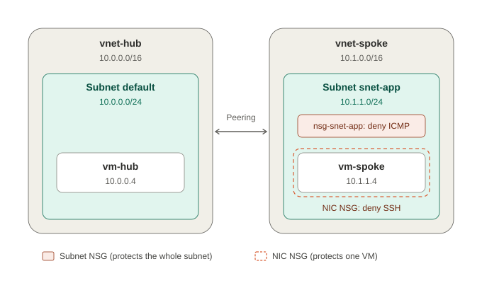

| Resource | Name | Details |
|---|---|---|
| Virtual network | `vnet-hub` | `10.0.0.0/16` · subnet `default` `10.0.0.0/24` |
| Virtual network | `vnet-spoke` | `10.1.0.0/16` · subnet `snet-app` `10.1.1.0/24` (private subnet) |
| VM | `vm-hub` | Ubuntu 24.04 · `10.0.0.4` · **no public IP** |
| VM | `vm-spoke` | Ubuntu 24.04 · `10.1.1.4` · **no public IP** |
| Peering | `peer-hub-to-spoke` / `peer-spoke-to-hub` | Connected, fully synchronized |
| NSG (subnet) | `nsg-snet-app` | Priority 100: **Deny ICMP** from `10.0.0.0/16` |
| NSG (NIC) | `nsg-vm-spoke-nic` | Priority 100: **Deny TCP 22 (SSH)** from `10.0.0.0/16` |

VMs were managed through the **Serial console** only: no public IP, no open ports.

## ✅ Tests and results (from vm-hub to vm-spoke)

| # | Situation | `ping 10.1.1.4` | `nc -zv 10.1.1.4 22` | Why |
|---|---|---|---|---|
| 1 | No peering | ❌ 100% loss | – | Separate VNets have no route to each other |
| 2 | Peering connected | ✅ 0% loss (~0.6 ms) | – | Peering = private link on the Microsoft backbone |
| 3 | NSG created but **not associated** | ✅ still passes | – | An NSG does nothing until attached to a subnet or NIC |
| 4 | Subnet NSG associated | ❌ 100% loss | ✅ succeeded | Rule 100 denies ICMP; SSH matches rule 65000 *AllowVnetInBound* |
| 5 | + NIC NSG (deny SSH) | ❌ 100% loss | ❌ timed out | Subnet allows SSH, but the NIC NSG denies it: **both must allow** |
| – | Cleanup | | | Resource group deleted |

## 💡 What I learned

- **VNet peering:** address spaces must **not overlap**; a peering is **two links** (one per direction) and shows *Connected* only when both exist; peering is **not transitive** (A↔B and B↔C does not give A↔C).
- **NSG rule processing:** rules are checked by **priority (lowest number first)**; the **first match wins** and processing stops. Default rules (65000+) allow VNet traffic and load balancer probes, then **DenyAllInBound**.
- **Subnet NSG vs NIC NSG:** a subnet NSG protects every VM in the subnet (preferred); a NIC NSG protects one VM. Inbound traffic is checked by the **subnet NSG, then the NIC NSG**; outbound in the reverse order. One *deny* is enough to block.
- **Troubleshooting:** check **"Associated with"** first; use **VM → Networking → Network settings** or **NIC → Effective security rules** to see every rule that applies.
- **`timed out` vs `connection refused`:** *timed out* usually means a firewall/NSG silently dropped the packet; *refused* means the packet reached the VM but no service listens.
- **Private subnet:** VMs had no outbound internet access (`apt install` failed), which is more secure by default.
- **Azure Virtual Network Manager:** the effective rules also showed an *admin network security group* that I did not create. Security admin rules from AVNM are evaluated **before** NSGs and cannot be overridden by NSG owners.

## 📸 Screenshots

> Subscription IDs are hidden.

**1. vnet-hub (10.0.0.0/16)**
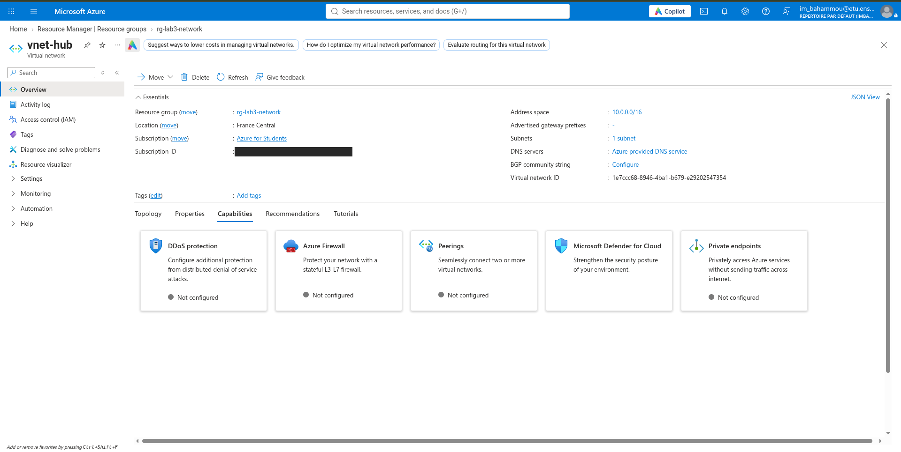

**2. vnet-spoke (10.1.0.0/16), no overlap with the hub**
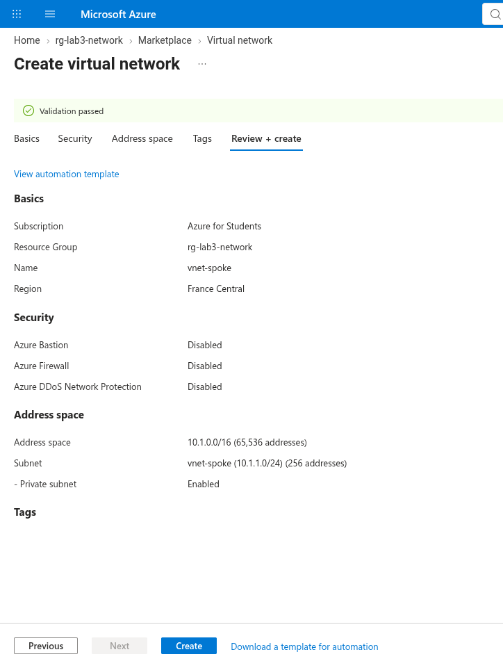

**3–4. vm-hub (10.0.0.4) and vm-spoke (10.1.1.4), no public IP**
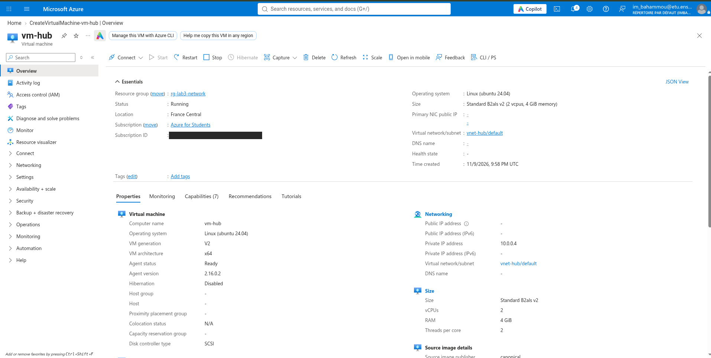
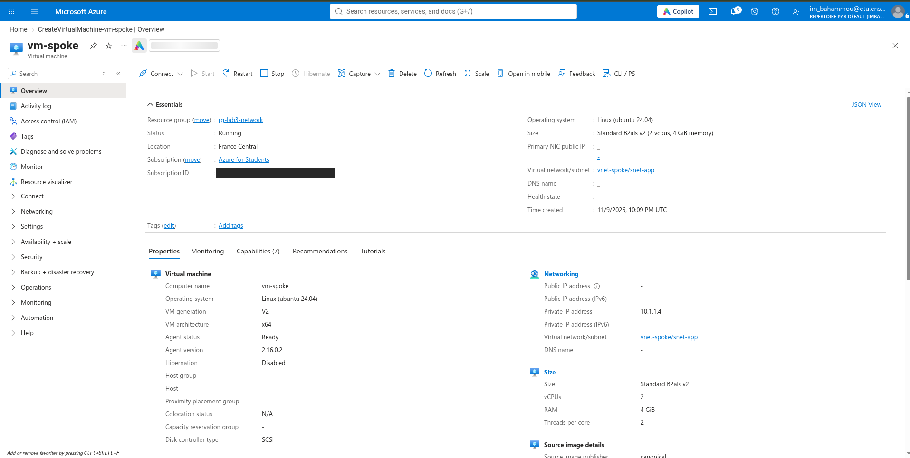

**5. Ping without peering: 100% packet loss**
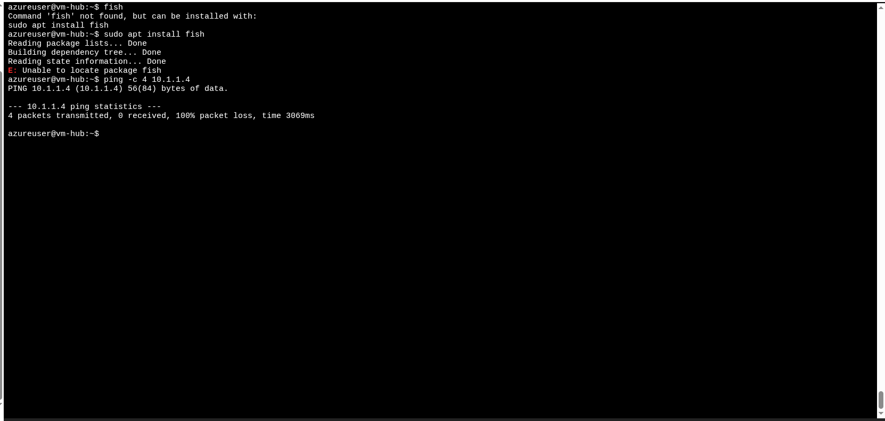

**6. Peering connected and fully synchronized**
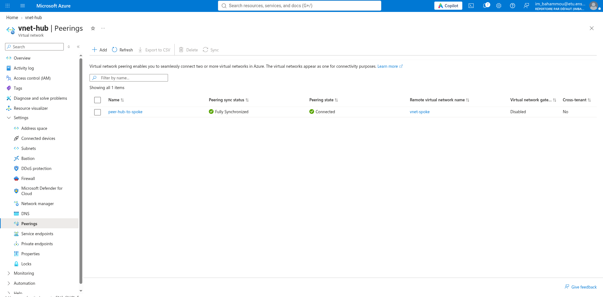

**7. Ping with peering: 0% packet loss**
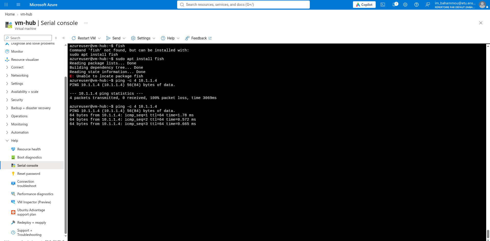

**8. Troubleshooting: rule correct but NSG associated with 0 subnets, 0 NICs**
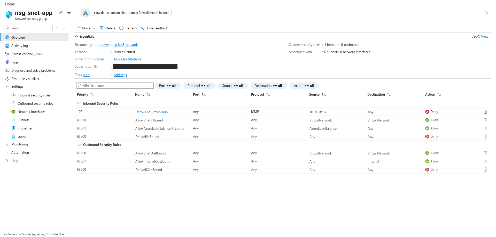

**9. Subnet NSG associated: ping blocked, SSH still allowed**
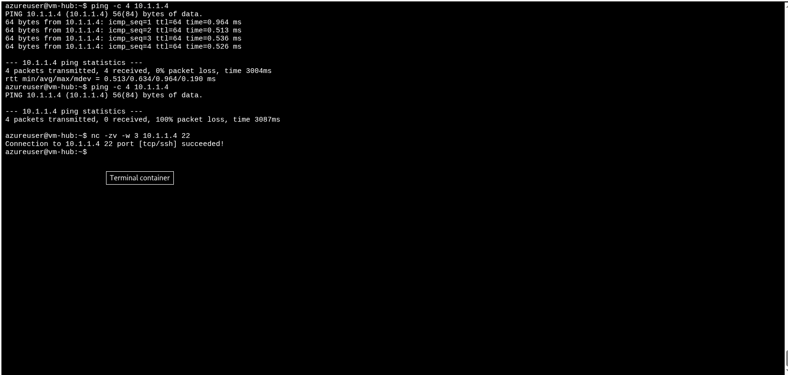

**10. Both NSGs on vm-spoke: subnet (deny ICMP) and NIC (deny SSH)**
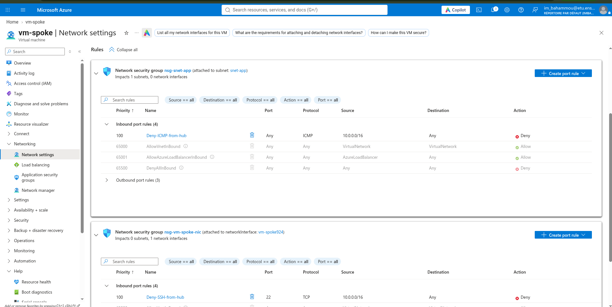

**11. NIC NSG blocks SSH: connection timed out**
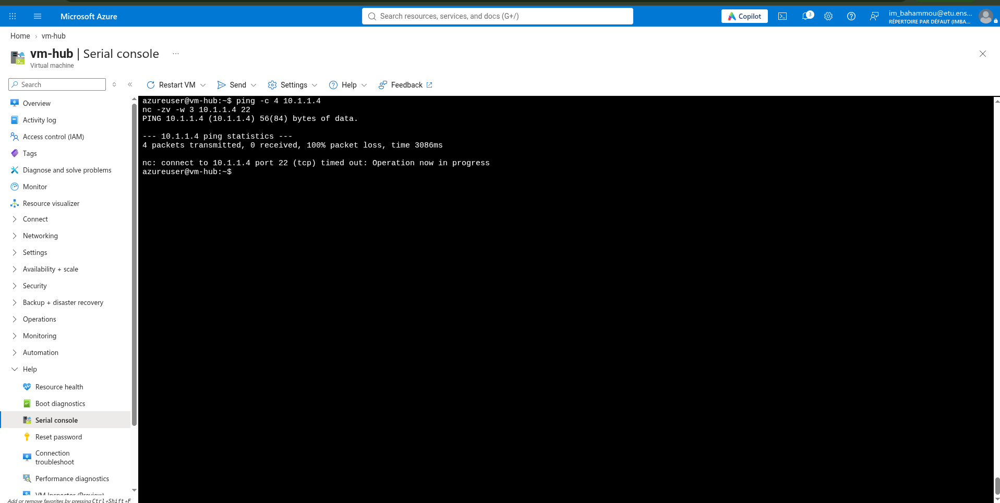

**12. Effective security rules on the NIC: both NSGs plus a Network Manager configuration**
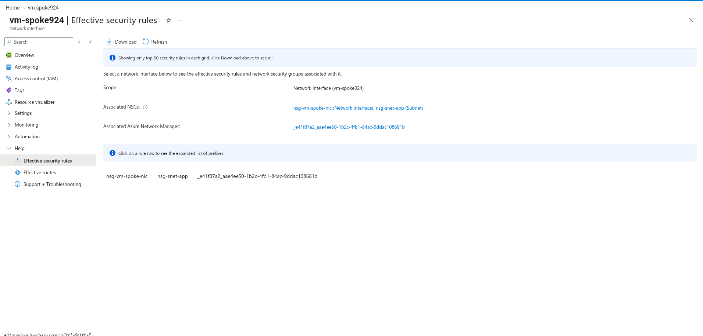

## 🔜 Next

- Lab 04: Load Balancer, Azure Bastion and Network Watcher

---
*Part of my 6-month journey to become a Cloud Infrastructure Engineer.*
