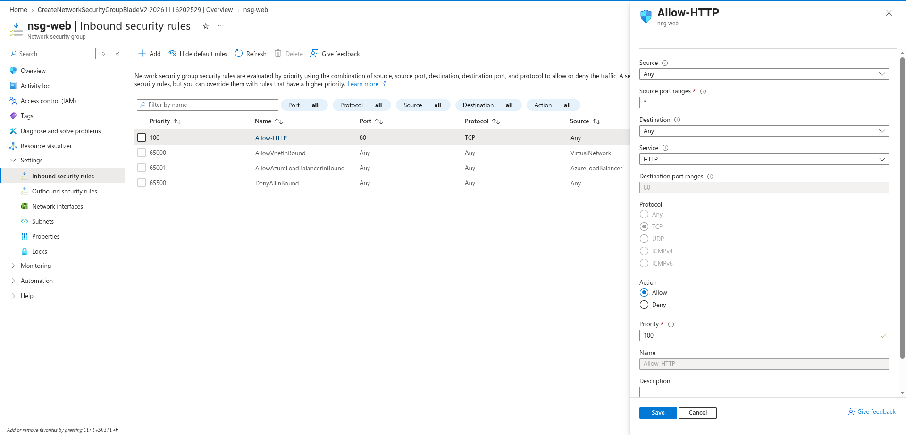
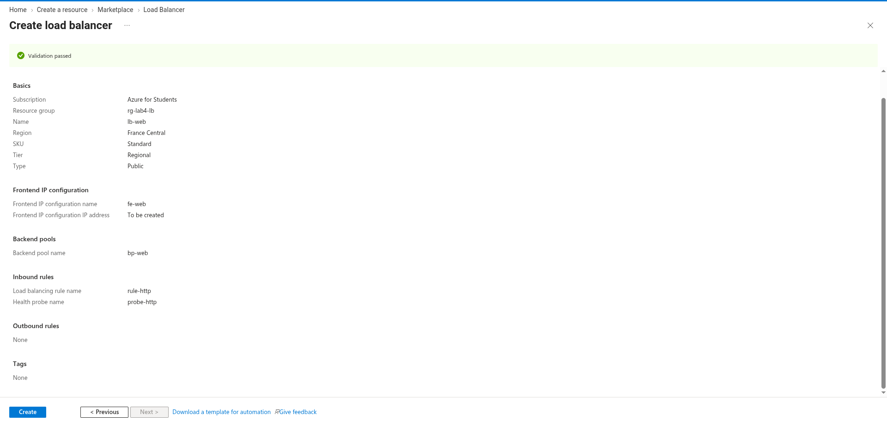
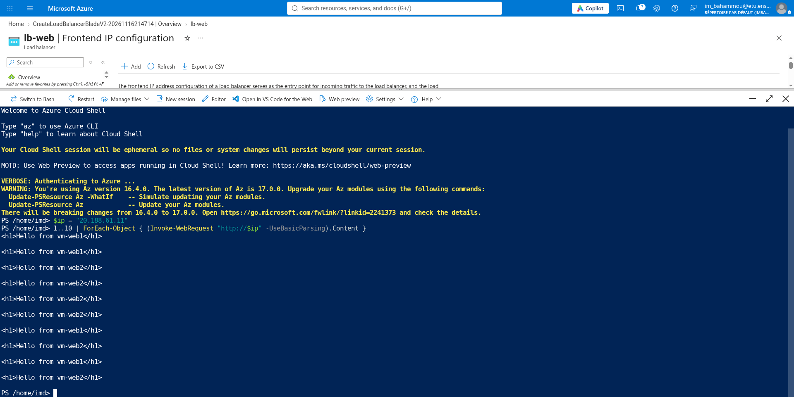
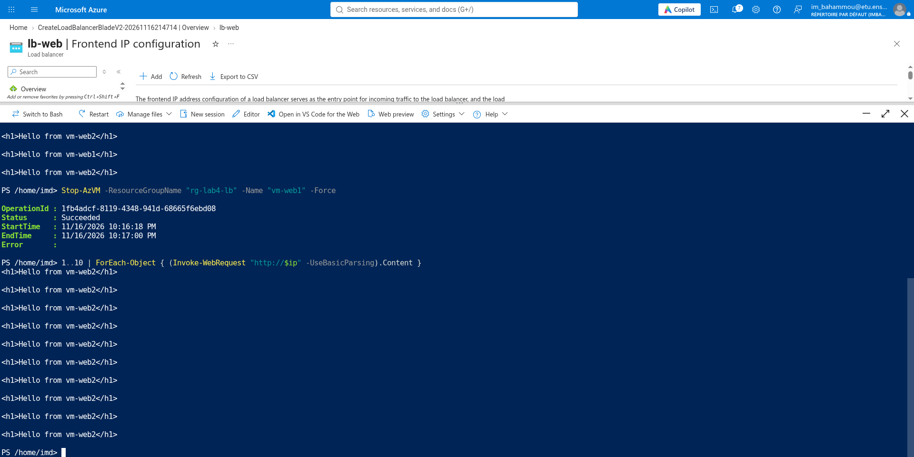
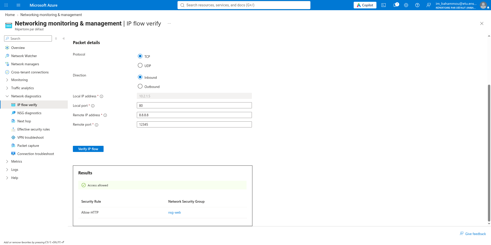

# Lab 04 – Azure Load Balancer, Cloud Shell and Network Watcher

> AZ-104 preparation · Domain: **Implement and manage virtual networking** / **Deploy and manage compute**
> Environment: Azure for Students subscription · France Central

## 🎯 Goal

Make a small website **highly available**: two web servers behind a public **Standard Load Balancer**, so the site stays up when one server fails.

## 🏗️ What I built

```
Internet ──► Public IP (fe-web) ──► lb-web ──► bp-web ──┬──► vm-web1  10.2.1.4
                                    rule-http  probe-http └──► vm-web2  10.2.1.5
                                    TCP 80     HTTP 80 /     (vnet-web 10.2.0.0/16 · snet-web 10.2.1.0/24 · nsg-web)
```

| Resource | Name | Details |
|---|---|---|
| Virtual network | `vnet-web` | `10.2.0.0/16` · subnet `snet-web` `10.2.1.0/24` (private subnet) |
| NSG (subnet) | `nsg-web` | Priority 100 **Allow-HTTP** TCP 80 from Any |
| VMs | `vm-web1`, `vm-web2` | Ubuntu 24.04 · **no public IP** · created with **PowerShell** in Cloud Shell |
| Custom data | — | Builds `Hello from <hostname>` and runs `python3 -m http.server 80` as a systemd service |
| Load balancer | `lb-web` | Standard, public, regional |
| Frontend IP | `fe-web` / `pip-lb-web` | The only public address |
| Backend pool | `bp-web` | vm-web1, vm-web2 (NIC based) |
| Health probe | `probe-http` | HTTP port 80, path `/`, every 5 s |
| LB rule | `rule-http` | TCP 80 → 80, no session persistence |

## ⚙️ VMs created with PowerShell (Cloud Shell)

Variables, a `foreach` loop to build both VMs, and `try/catch` to try several sizes until one works:

```powershell
foreach ($i in 1,2) {
    $vm = New-AzVMConfig -VMName "vm-web$i" -VMSize $s
    $vm = Set-AzVMOperatingSystem -VM $vm -Linux -ComputerName "vm-web$i" -Credential $cred -CustomData $customData
    # image, Standard SSD disk, existing NIC (no public IP), boot diagnostics...
    New-AzVM -ResourceGroupName $rg -Location $loc -VM $vm -ErrorAction Stop
}
```

### 🛠️ Problem I solved: `SkuNotAvailable`

Every size failed when I put the VMs in **availability zones 1 and 2**. I checked the SKU restrictions:

```powershell
Get-AzComputeResourceSku -Location francecentral | Where-Object { $_.ResourceType -eq "virtualMachines" -and $_.Name -in $sizes } |
  Select-Object Name, @{n="Restrictions"; e={ ($_.Restrictions | ForEach-Object { "$($_.Type): $($_.ReasonCode)" }) -join "; " }}
```

```
Standard_B1s       Location: NotAvailableForSubscription; Zone: NotAvailableForSubscription
Standard_B2ats_v2  Zone: NotAvailableForSubscription
Standard_D2as_v5   Zone: NotAvailableForSubscription
```

**Cause:** the student subscription cannot use availability zones. **Fix:** create the VMs without a zone, with an allowed size. In a normal subscription, I would place the VMs in different zones for zone-level high availability.

## ✅ Tests and results

| # | Test | Result |
|---|---|---|
| 1 | Open `http://<public IP>` in a browser | ✅ `Hello from vm-web1` |
| 2 | 10 requests from Cloud Shell | ✅ **4 × vm-web1, 6 × vm-web2**: traffic is shared |
| 3 | `Stop-AzVM vm-web1`, then 10 requests | ✅ **10 × vm-web2**: the health probe removed web1, site still up |
| 4 | IP flow verify, internet → vm-web2 **TCP 22** | ❌ Denied by `DenyAllInBound` |
| 5 | IP flow verify, internet → vm-web2 **TCP 80** | ✅ Allowed by `Allow-HTTP` (nsg-web) |
| – | Cleanup: `Remove-AzResourceGroup -Name rg-lab4-lb -Force` | ✅ Nothing left running |

## 💡 What I learned

- **Load balancer = frontend IP + backend pool + health probe + rule.**
- Azure Load Balancer uses a **5-tuple hash** (source IP/port, destination IP/port, protocol), not round-robin. **Session persistence** (client IP) keeps a visitor on one server.
- The **health probe** takes a failed server out of rotation automatically: no downtime.
- The default NSG rule **AllowAzureLoadBalancerInBound** lets the health probe reach the VMs.
- **Custom data** runs a script at first boot: the servers configured themselves.
- **Cloud Shell + PowerShell:** variables, loops and `try/catch` make deployments repeatable (first step toward Infrastructure as Code).
- `Get-AzComputeResourceSku` explains why a VM size cannot be deployed (location or zone restrictions).
- **Network Watcher IP flow verify** names the exact NSG rule that allows or denies a packet.
- **VM power states:** *running* and *stopped from inside the OS* still cost compute; *stopped (deallocated)* from Azure does not.
- Mistakes I fixed: the NSG rule first opened **443** instead of **80**; IP flow verify was first set to **UDP** instead of **TCP**.

## 📸 Screenshots

**1. NSG rule: HTTP port 80 allowed**


**2. Load balancer configuration (frontend, backend pool, rule, health probe)**


**3. The website through the load balancer's public IP**


**4. 10 requests: traffic shared between vm-web1 and vm-web2**


**5. vm-web1 stopped: all 10 requests answered by vm-web2**


**6–7. IP flow verify: SSH denied, HTTP allowed**



## 🔜 Next

- Lab 05: Storage accounts (Blob, Azure Files, SAS, lifecycle management)

---
*Part of my 6-month journey to become a Cloud Infrastructure Engineer.*
